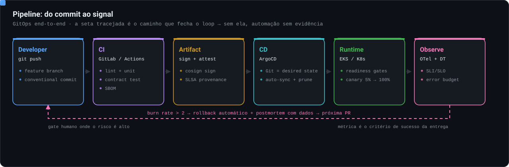

# profile-assets

Arquivos visuais usados no README de perfil [`jraalves`](https://github.com/jraalves) e no
[portfólio](https://jraalves.github.io/portfolio/). Ficam num repositório à parte por um motivo
prático: o README do perfil é **um arquivo só**, então os diagramas precisam ser servidos por
URL absoluta. Cada desenho existe em duas formas de propósito: `.svg` (nítido em qualquer tela)
e `.png` rasterizado em 2× (fallback para qualquer cliente que recuse SVG).

Nenhum arquivo aqui contém marca de cliente, nome de sistema interno, carga, volume financeiro
ou credencial. Os números são de ambientes de laboratório ou percentuais relativos cujo
denominador está descrito no README de cada repositório.

| Arquivo | O que mostra | Por que existe |
|---|---|---|
| `banner.svg` / `.png` | Cabeçalho do perfil: papel, pilha e a linha `push → build → test → deploy → sync → run → observe` | deixa claro em um segundo que o fio condutor é o loop de entrega, não a ferramenta |
| `pipeline.svg` / `.png` | Pipeline end-to-end com a seta que fecha o loop (telemetria realimentando a próxima PR) e o gate humano onde o risco é alto | GitOps sem medição é automação sem evidência |
| `pyramid.svg` / `.png` | Pirâmide de observabilidade com o *share* do budget por camada | cada pergunta é respondida numa camada específica; inverter a base é o erro clássico |
| `golden.svg` / `.png` | Os quatro sinais que eu olho primeiro (p95 de jornada, tráfego com baseline, erro vs. budget, saturação vs. P90) | todo alerta precisa de caminho até um humano que possa agir |
| `career-trace.svg` / `.png` | Carreira desenhada como trace distribuído: um span por período, sobreposições e lacunas visíveis | esconder sobreposição e buraco é a primeira coisa que um recrutador técnico percebe |
| `stack.svg` / `.png` | Stack agrupada por função, com barra de profundidade real de uso | ordem = onde passei mais tempo; profundidade ≠ certificado comprado |
| `retrato/avatar_rounded.png` | Retrato sobre fundo de tecnologia | identidade visual do perfil |

## Como referenciar num README

```html

```

`raw.githubusercontent.com` responde `Content-Type: image/svg+xml` e o GitHub renderiza o ``
normalmente dentro de README (medido: `200 · image/svg+xml` e `200 · image/png`, com screenshot
da página real). Se algum proxy corporativo bloquear SVG, troque a extensão por `.png` — é o
mesmo desenho.

## Reproduzir

Os desenhos são gerados por um script que escreve SVG a partir de dados estruturados (sem
biblioteca de gráficos) e rasterizados com Chromium headless em escala 2×. Editar o SVG na mão
não é o caminho: mexa nos dados, regere o SVG, regere o PNG — assim texto e geometria continuam
 coerentes e nenhum número entra no desenho por conta própria.

A cópia do README de perfil que consome estes arquivos está em
[`perfil-readme-copia.md`](perfil-readme-copia.md).
