<div align="right"><a href="https://jraalves.github.io/portfolio/"></a></div>

# João Renato Alves


<p>
  <a href="https://www.linkedin.com/in/joaorenatoalves-sre"></a>
  <a href="https://jraalves.github.io/portfolio/"></a>
  
  
  
  
  
</p>

> **Especialista SRE | Observabilidade | MBA Arquitetura de Soluções | SRE Certified**
>
> Trabalho com sistemas críticos de alta disponibilidade em meios de pagamento, bancário, telecom e
> seguros. O que eu faço, em uma frase: **transformo sinal bruto em decisão** — SLI/SLO com error
> budget que trava release, correlação de jornada entre Linux e Mainframe, e agentes de IA que
> calculam MTTR e recorrência antes de agir.

- 🔭 **Agora:** Davis AI e Correlation ID entre Linux e Mainframe; plataforma interna de agentes de IA
  para SRE ligada em observabilidade, tickets, deploy e cluster.
- 🧭 **Aberto a:** SRE sênior, tech lead de plataforma/confiabilidade e projetos de observabilidade
  em meios de pagamento, fintech e nuvem.
- 📫 **Como falar comigo:** [LinkedIn](https://www.linkedin.com/in/joaorenatoalves-sre) — respondo em
  até um dia útil. Este repositório é a versão pública do meu trabalho; o portfólio é a versão guiada.

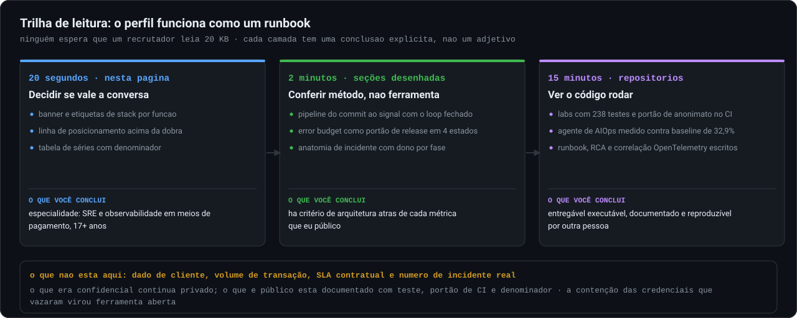

---

```promql
count by (era) (career_span{pessoa="joaorenatoalves"})
```

| série | valor | como foi medido |
|---|---:|---|
| `anos_em_tecnologia` | 17+ | 2009 → hoje: suporte, infraestrutura, middleware, SRE |
| `anos_em_sre_observabilidade` | 7+ | capacidade, SLO, observabilidade e confiabilidade em produção crítica |
| `ambientes_de_producao_critica` | 16 | plataformas com contrato de disponibilidade e plantão |
| `mttr_em_incidente_critico` | −50% | antes/depois do processo de RCA e playbooks, mesma classe de incidente |
| `tempo_de_deteccao` | −70% | janela introduced→detected, medida em dashboards de jornada |
| `frequencia_de_deploy` | +90% | deploys/semana após GitOps com ArgoCD e pipeline de validação |

Números relativos têm denominador descrito no README de cada repositório. Não publico volume de
transações, SLA contratual ou resultado financeiro de cliente: isso é dado de quem pagou pela
plataforma, não meu.

## Repositórios em destaque

| repositório | o que ele faz, com número | stack | o que já foi verificado |
|---|---|---|---|
| [fiscal-automation-case](https://github.com/jraalves/fiscal-automation-case) | caso anonimizado de automação fiscal em Kubernetes: a aplicação sob **Ingress** com OAuth2 Proxy, `default-deny` e **dados sintéticos**, host ilustrativo `automacao.github.io` | Kubernetes, Ingress-NGINX, cert-manager, OAuth2 Proxy, Python | `validar_manifests.py`: **8 invariantes**, exit **0** · **200** registros sintéticos determinísticos (seed `20261122`) · varredura de identidade e credencial: **0 ocorrências** |
| [sre-senior-lab](https://github.com/jraalves/sre-senior-lab) | laboratório de SRE sênior: SLO com error budget, burn rate, capacity/FinOps e um agente de triagem avaliado em **89,9%** de categoria e **76,0%** de runbook contra baseline de **32,9%** (79 incidentes sintéticos) | Python, Prometheus, Grafana, Shell | **238 testes** passando em 1,06 s · `lint.sh` limpo · portão de anonimato sem ocorrência |
| [observability-golden-signals-stack](https://github.com/jraalves/observability-golden-signals-stack) | stack dos quatro sinais de ouro com correlação de logs, traços e métricas e runbook por família de alerta | Prometheus, Grafana, Loki, Tempo, OTel, Dynatrace | **8** grupos, **60** recording rules, **10** alertas, **4** runbooks, **184** métricas do app validadas |
| [sre-aiops-agent-reference](https://github.com/jraalves/sre-aiops-agent-reference) | referência de agente de AIOps: correlação, enriquecimento, veredito com confiança e ação sob gate humano | Python, FastAPI, OpenAI-compatível, Jira/ArgoCD/K8s (contratos) | `make check` e `make gate` com exit **0** · **42 testes** |
| [otel-correlation-design](https://github.com/jraalves/otel-correlation-design) | desenho de correlação de jornada com W3C Trace Context atravessando fronteira sem tracing nativo (Linux ↔ Mainframe) | OpenTelemetry, Java, COBOL, OTLP | validador `--strict`: **0 erros**, **0 avisos** em 3 dashboards |
| [git-secret-guard](https://github.com/jraalves/git-secret-guard) | hook que barra credencial antes do commit, com sanitização de histórico e varredura de resíduo | Bash, Python, git | **12/12** casos do teste do hook corretos |
| [profile-assets](https://github.com/jraalves/profile-assets) | os **12** diagramas deste perfil em SVG + PNG 2×, gerados por script a partir de dados | SVG puro, Python, Chromium headless | todos os arquivos respondem `200` sem token · XML válido |
| [portfolio](https://github.com/jraalves/portfolio) | site de portfólio em Pages: trajetória como trace, pirâmide interativa e caso de automação fiscal anonimizado, em pt-BR e EN | HTML/CSS/JS estático | publicado em [jraalves.github.io/portfolio](https://jraalves.github.io/portfolio/) |

## Como eu penso, desenhado

### 1. Pipeline: do commit ao signal

GitOps não é ferramenta, é contrato. O que fecha o loop é a seta tracejada: a métrica decide se a
entrega deu certo.

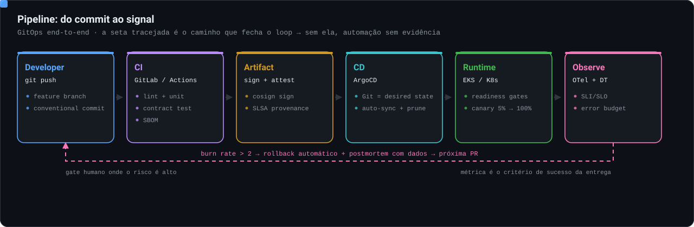

Gate humano fica onde o risco é alto; promoção canário, rollback e postmortem ficam onde a métrica
já é critério de sucesso. Sem evidência, automação é só velocidade sem direção.

### 2. Pirâmide de observabilidade: onde cada pergunta é respondida


Métrica alerta, trace localiza, log explica, profiling prova. Inverter a base (log em todo lugar,
métrica tarde demais) é o erro que gera conta alta e resposta lenta — por isso o *share* de budget
aparece desenhado, não escondido.

### 3. Os quatro sinais que eu olho primeiro

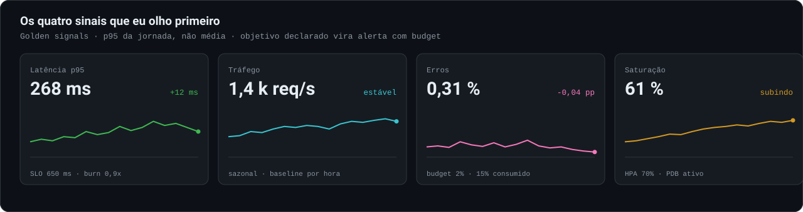

Latência no **p95 da jornada** (não a média do endpoint), tráfego com baseline sazonal por hora,
erro sempre acompanhado do consumo de budget, saturação antes de o cliente sentir. Se o número não
gera ação, ele vira dashboard morto — e dashboard morto é *toil* decorativo.

### 4. Carreira como trace distribuído

Cada barra é um período real de trabalho, com sobreposições e lacunas visíveis. O gráfico mostra o
que o CV mostra.


### 5. Stack agrupada por função

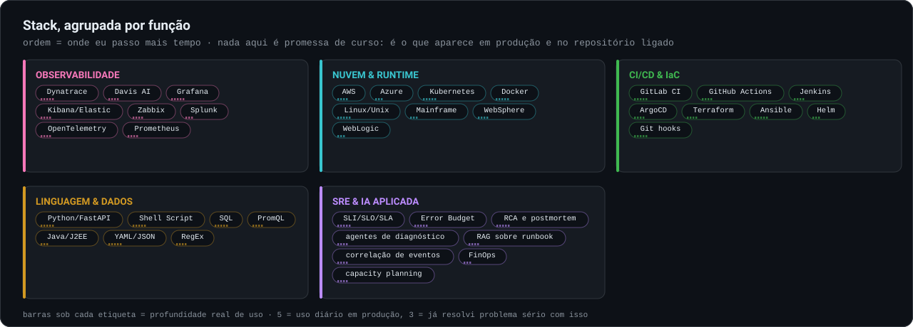

A barra sob cada etiqueta é profundidade de uso real, não certificado comprado.

### 6. Error budget como política de release

Budget não é clima de time: é conta com duas janelas e quatro estados de portão. O gráfico mostra
consumo acumulado no mês; ao lado, o que cada estado proíbe e quem assina.

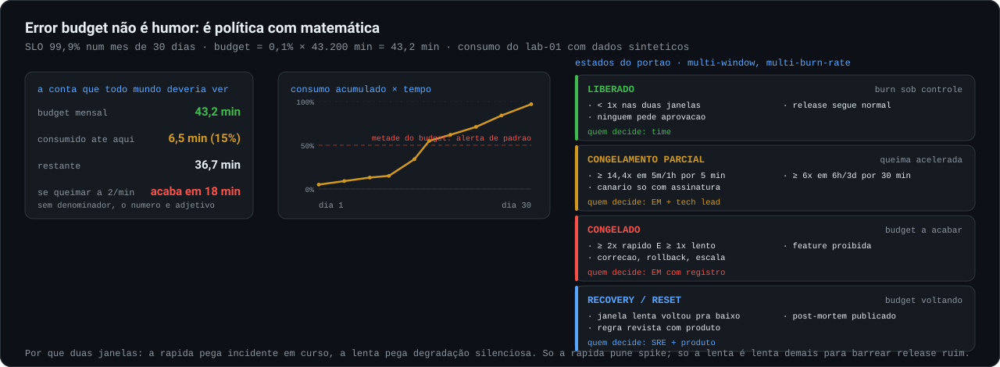

Release congelado por número tem mais chance de ser respeitado do que por cansaço. E a regra volta à
mesa no estado `RECOVERY`, junto com o post-mortem — senão o portão vira punição, não política.

### 7. Anatomia de um incidente

A linha do tempo é o produto. Cada fase tem dono, e a janela `introduced → detected` é a mais barata
de encurtar com arquitetura (sacrifício de cardinalidade, regra de arco, SLO de detecção).


`MTTL` existe no desenho de propósito: se o post-mortem não muda o sistema, o próximo incidente é
agendamento, não surpresa. As durações são do `lab-03` com dados sintéticos; os percentuais do CV
estão rotulados como tal.

### 8. Agente de AIOps com veredito por evidência

Plataforma interna ligada em observabilidade, tickets, deploy e cluster. O que importa não é o
modelo, é a cadeia: correlação, enriquecimento, veredito com confiança, ação com gate humano e
medida do resultado.


No laboratório que reproduz o método, o agente acerta 89,9% de categoria e 76,0% de runbook sobre 79
incidentes sintéticos, contra 32,9% do baseline da classe majoritária. Sem esse baseline, o primeiro
número é enfeite.

### 9. Capacidade e FinOps na mesma reunião

Projeção com sazonalidade de fechamento, faixa de ±25% na demanda e a data em que a decisão ainda é
barata. À direita, o que cada escolha custa e o preço do recurso sem tag.

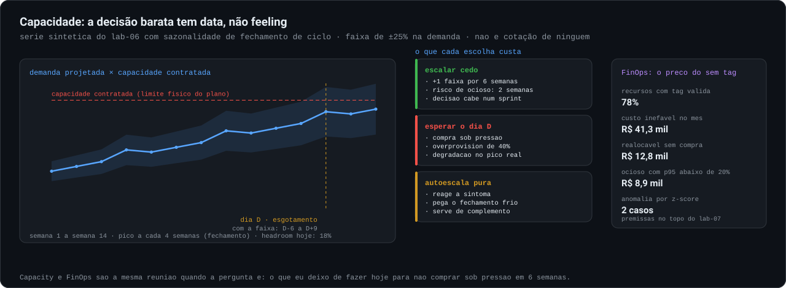

Escalar cedo é decisão de sprint; esperar o dia D é compra sob pressão com overprovision.
Autoescala sozinha reage a sintoma e pega o pico de fechamento frio — ela complementa a previsão,
não a substitui.
---
### 10. A porta de entrada de um sistema sensível
O padrão que eu uso quando uma aplicação toca dado de terceiro e ainda assim precisa ser visitável:
host de exemplo (`automacao.github.io`), TLS obrigatório com redirect, autenticação delegada no
**OAuth2 Proxy** antes do app, `NetworkPolicy` *default-deny* no namespace e carga **sintética** no
lugar do dado real.
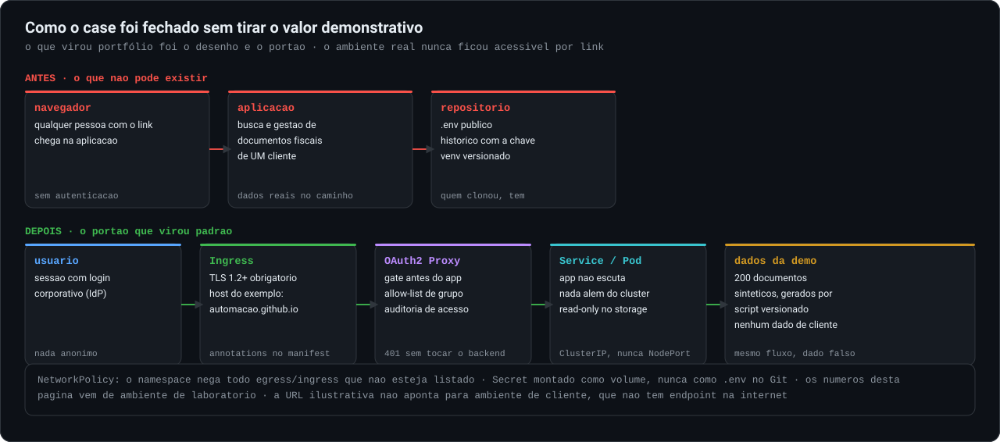
Isso não é enfeite de arquitetura: é o que impede que um painel de auditoria apareça na busca do
GitHub com sessão aberta. Está reproduzido em manifestos validáveis em
[fiscal-automation-case](https://github.com/jraalves/fiscal-automation-case).
---
## Cronologia (primeira → última)

| Período | Papel | Onde | Evidência |
|---|---|---|---|
| mar/2009 – dez/2009 | Estágio em Business Intelligence | Keyword Tecnologia | scripts, procedures, packages e views para sistemas de gestão |
| out/2010 – jan/2013 | Analista de Sistemas Júnior | Masterdom · PRODESP · TJ-SP | manual online em HTML/CSS/JS e desenvolvimento J2EE no WebSphere |
| jan/2013 – jan/2014 | Analista de Sistemas · Suporte a Aplicações | Produban · Banco Santander | portais de grande acesso em produção: Internet Banking e intranet |
| jan/2014 – jan/2015 | Analista de Sistemas · Suporte a Aplicações | AGSNasoft · Banco Santander | suporte à implantação de infraestrutura de servidores e portais |
| fev/2014 – fev/2015 | Analista de Infraestrutura Pleno | Capgemini · Bradesco | desenho da arquitetura de infraestrutura dos servidores WebSphere |
| mar/2015 – mai/2017 | Analista de Middleware Pleno | Connectis · Telefônica/Vivo | migração do ambiente móvel/fixo de São Paulo para o NDC |
| jan/2018 – jul/2018 | Analista de Middleware | HITSS · NET · Claro · Embratel | instalação, configuração e manutenção de WebLogic e Oracle SOA Suite |
| ago/2018 – set/2019 | Analista de Middleware | Indra | deploy em integração contínua com pipeline Jenkins e atualização de imagens |
| set/2019 – jan/2022 | SRE · Middleware | Vector ITC · Santander | aplicações de pagamento móvel e Internet Banking em alta disponibilidade |
| fev/2022 – nov/2022 | Capacity Planning · SRE | Telefônica Tech · Vivo Digital | planejamento de capacidade em nuvens públicas/privadas e missão crítica |
| ago/2022 – mar/2023 | Arquitetura de Soluções · Middleware · SRE | Financeira Alfa | arquitetura de middleware e distribuição de aplicações on-premises |
| abr/2023 – dez/2023 | Middleware · DevOps Engineer · SRE | Meta · Tokio Marine Brasil | −50% no tempo médio de resposta a incidentes críticos e −70% no tempo de detecção |
| dez/2023 – out/2024 | Site Reliability Engineer | Kalendae | acompanhamento de MTTR, MTBF, MTTA e MTTF junto a desenvolvimento e produto |
| dez/2024 – abr/2025 | Site Reliability Engineer | Inmetrics · Claro (projeto E2E) | arquitetura do Capacity Claro E2E e calculadora de métricas de negócio |
| nov/2025 – atual | Freelancer · Consultor de Tecnologia | JRA Corporation · ONEtoONE | plataforma de busca e gestão de informação fiscal + painéis de observabilidade como serviço |
| abr/2026 – atual | Especialista em SRE e Observabilidade | Cielo · Barueri, SP | Dynatrace + Davis AI, Correlation ID entre Linux e Mainframe, plataforma interna de agentes de IA para SRE |

Sobreposições (2014–2015, ago–nov/2022, e freelancer com atual) e lacunas (jun–dez/2017,
mai–out/2025) existem e aparecem no gráfico. Disfarçar isso é a primeira coisa que um recrutador
técnico percebe.

## O que eu resolvo

| problema | como eu entro | onde está documentado |
|---|---|---|
| Alerta demais, sinal de menos | correlação por tag, baseline por jornada, regra de arco em vez de threshold fixo | [observability-golden-signals-stack](https://github.com/jraalves/observability-golden-signals-stack) |
| Incidente que ninguém sabe quanto custou | SLI/SLO com produto, error budget como moeda de release, MTTR e recorrência rastreáveis | [sre-senior-lab · lab-03](https://github.com/jraalves/sre-senior-lab) |
| Jornada quebrada entre plataformas | Correlation ID e W3C Trace Context atravessando fronteira sem tracing nativo | [otel-correlation-design](https://github.com/jraalves/otel-correlation-design) |
| Toil repetitivo | playbooks, expurgo automatizado, runbook executável com aprovação humana | [sre-aiops-agent-reference](https://github.com/jraalves/sre-aiops-agent-reference) |
| Nuvem cara sem explicação | capacity planning e FinOps com projeção de demanda virando compra planejada | [sre-senior-lab · lab-06/07](https://github.com/jraalves/sre-senior-lab) |
| Credencial vazando no Git | hook com padrões de segredo, sanitização de histórico e varredura de resíduo | [git-secret-guard](https://github.com/jraalves/git-secret-guard) |

## Documentação pública

Escrever é parte do trabalho, não um anexo. O que existe hoje, aberto para leitura:

- **Runbooks e alertas com caminho de ação** — `observability-golden-signals-stack` (4 runbooks com
  gatilho, hipótese, comando de verificação e critério de saída).
- **RFC de correlação de jornada** — `otel-correlation-design`, com o desenho de propagação
  W3C Trace Context e as decisões que foram rejeitadas e por quê.
- **Contrato do agente de AIOps** — `sre-aiops-agent-reference`: entradas, saídas, o que o modelo
  não pode decidir sozinho e como o resultado é medido contra baseline.
- **Posmortem e relatório de avaliação** — `sre-senior-lab` traz o template de post-mortem e o
  `evaluate.py` que produz as métricas citadas acima, com dados sintéticos.
- **Portfólio** — [jraalves.github.io/portfolio](https://jraalves.github.io/portfolio/): a mesma
  trajetória em versão guiada, com página em português (principal) e em inglês.

## Formação e credenciais

- **MBA em Arquitetura de Soluções** — FIAP, 2014–2015.
- **Tecnologia em Informática para Gestão de Negócios** — FATEC-SP, 2008–2011.
- **DevOps Essentials Professional Certificate (DEPC)** — CertProf, 2019.
- **Em rota (plano, não credencial):** CKA (Kubernetes Administrator) e uma certificação de
  plataforma de observabilidade. Declaro como objetivo porque ainda não tenho o selo.

Idiomas, como no CV: português nativo; inglês, espanhol e francês em nível básico, em evolução — a
seção em inglês deste README é documentação escrita do trabalho, não prova de conversação.

## Sobre o que não está aqui

- **Dados de cliente.** O caso de automação fiscal aparece anonimizado em
  [fiscal-automation-case](https://github.com/jraalves/fiscal-automation-case): estrutura, arquitetura,
  portões de CI e método são públicos; nomes, cargas e números internos não são — e não há como
  reconstruí-los a partir do repositório.
- **Credenciais.** Repositórios antigos continham segredos. O tratamento foi contenção, sanitização
  de histórico e rotação de credenciais — não `git rm` com fé silenciosa. A ferramenta virou código
  aberto em [git-secret-guard](https://github.com/jraalves/git-secret-guard).
- **Métricas de produção.** Números de incidentes reais não são publicados. Onde há percentual
  (−50% resposta, −70% detecção), ele veio de medição acordada com a área, não de gráfico bonito.
- Repositórios sob acordo de confidencialidade ficam privados. Preferido isso a expor o ambiente de
  quem me contratou.

## Princípios que aparecem no código

- Todo alerta precisa de um caminho até um humano que possa agir; se não tem, é ruído.
- Detecção é produto: a janela de detecção entra na conversa de arquitetura junto com latência.
- Automação que escreve em produção exige aprovação, idempotência, kill switch e auditoria.
- Sem denominador, o número é adjetivo. Prefiro `−50% MTTR (medido assim…)` a `ótimo resultado`.
- Documentar é parte da operação: runbook que ninguém consegue seguir de madrugada não existe.
- Perfil sem contador de visita, sem streak e sem troféu: o que prova qualquer coisa aqui é
  repositório com teste, portão de CI e texto que outra pessoa consegue seguir de madrugada.

---

## English

**SRE Specialist | Observability | MBA in Solutions Architecture | SRE Certified.**
High-availability critical systems in payments, banking, telecom and insurance. 17+ years in
technology, 7+ of them making failure visible before it reaches the customer.

I turn raw signal into a decision: SLI/SLO with an error budget that gates releases, alerts that
either act or get silenced, automation that deletes toil, and postmortems that change the system
instead of decorating a runbook. Currently working with Dynatrace/Davis AI, OpenTelemetry,
Kubernetes/EKS, GitOps and applied AIOps — an internal agent platform that computes MTTR and
recurrence to support diagnosis and anticipate alerts.

The diagrams above are the method, each one stating its denominator:
[`pipeline.svg`](https://github.com/jraalves/profile-assets/blob/main/assets/pipeline.svg) closes the
delivery loop with observability feedback,
[`pyramid.svg`](https://github.com/jraalves/profile-assets/blob/main/assets/pyramid.svg) shows cost
per byte and what each layer answers, [`golden.svg`](https://github.com/jraalves/profile-assets/blob/main/assets/golden.svg)
shows the four signals I check first (p95 of the journey, not endpoint average),
[`career-trace.svg`](https://github.com/jraalves/profile-assets/blob/main/assets/career-trace.svg)
plots every role as a span of a distributed trace — overlaps and gaps included, because hiding them
is the first thing a technical recruiter notices.
[`error-budget.svg`](https://github.com/jraalves/profile-assets/blob/main/assets/error-budget.svg)
turns the budget into a four-state release gate,
[`incident-anatomy.svg`](https://github.com/jraalves/profile-assets/blob/main/assets/incident-anatomy.svg)
puts an owner on every phase of the timeline,
[`aiops-agent.svg`](https://github.com/jraalves/profile-assets/blob/main/assets/aiops-agent.svg)
shows the evidence chain behind an agent verdict, and
[`capacity-finops.svg`](https://github.com/jraalves/profile-assets/blob/main/assets/capacity-finops.svg)
dates the cheap decision, and
[`ingress-gate.svg`](https://github.com/jraalves/profile-assets/blob/main/assets/ingress-gate.svg)
is the entry pattern I use for anything that touches third-party data: sample host, forced TLS,
OAuth2 Proxy in front of the app, default-deny `NetworkPolicy` and synthetic payloads instead of
the client's records.

Repos come with what was actually verified: 238 tests in the SRE lab, an AIOps agent scored at 89.9%
category accuracy and 76.0% runbook accuracy against a 32.9% majority-class baseline, a strict
dashboard validator with zero errors and zero warnings, and a secret-scan hook passing 12/12 cases.
The fiscal automation engagement is published as
[`fiscal-automation-case`](https://github.com/jraalves/fiscal-automation-case): anonymised manifests,
a deterministic synthetic dataset (seed `20261122`, 200 records) and a validator with 8 invariants that
exits 0 — the client's name, payloads and internal figures are not in the repository and cannot be
reconstructed from it. Client data is published anonymized, production incident figures are not
published at all, and leaked credentials were contained, rotated and scrubbed from history — the tooling is now open in
[`git-secret-guard`](https://github.com/jraalves/git-secret-guard).

[Portfolio](https://jraalves.github.io/portfolio/) ·
[LinkedIn](https://www.linkedin.com/in/joaorenatoalves-sre) ·
Open to senior SRE, tech lead and platform reliability roles.

<!-- última revisão deste README: 22/11/2026 · assets: profile-assets -->
